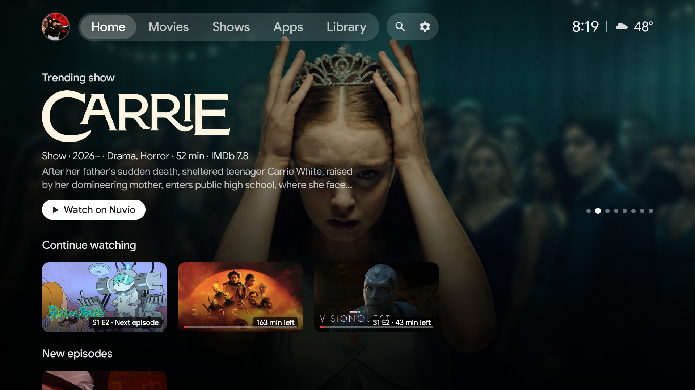
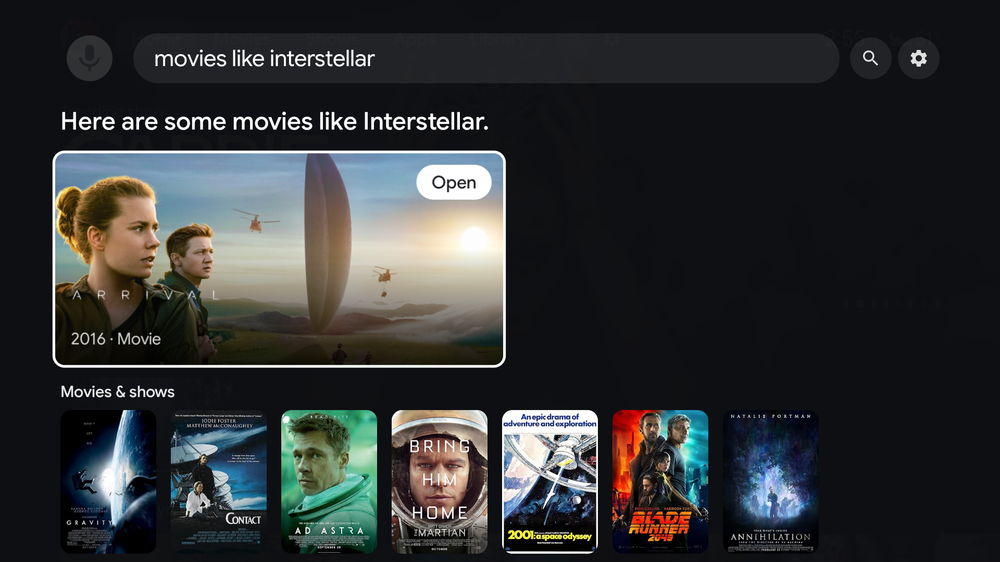
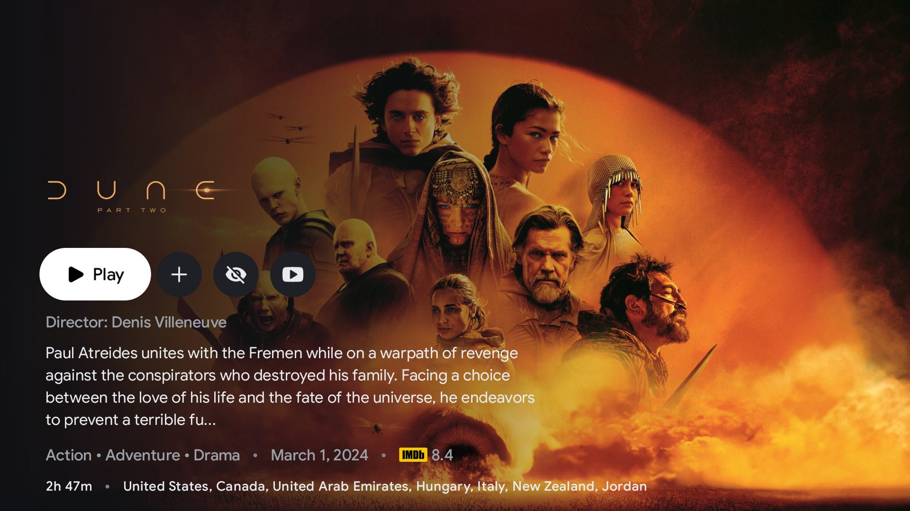

# Vibe TV

Google TV looks great, but its an ad riddled piece of shit now and expects your content to come from bougee premium name brand streaming services. And even worse - It uses Gemini as a mediocre voice search assistant thing. Google strikes again. 

That's where VibeTV comes in. The familiar nice looking launcher with content recommendations etc etc, but powered by whatever less legitimate content sources you want through Nuvio. I know what you are. 🏴‍☠️

Anyways this repo has 2.5 components - A launcher replacement,  an assistant replacement (part of the  launcher) and a nuvio fork. 

The launcher looks like google tv, but sources its content/continue watching/etc etc from nuvio. glorious integration. And you still have apps. Thats about all it has. Its a TV launcher, you click shows and movies to burn your life away watching, and this streamlines that process.

The assistant is intended to power voice search and feed your requests cleanly into Nuvio. it has basic commands like "play (show)" etc, and falls back to asking a chinese LLM if your request doesnt fall into its basic commands. Sweet, sweet natural language processing is here. Its basically AGI. 

The nuvio fork - slightly restyled to match the launcher and a couple other features for better integration.  Does not support signing into an actual nuvio server account, you must selfhost, and build pointed at your selfhost. or just don't use an account.  Luckily, im sure you have a NAS you can go toss another docker image and forget about it. 

| Assistant: "movies like interstellar" | Vibe Nuvio title page |
|---|---|
|  |  |

| Folder | App | What it is |
|---|---|---|
| [`launcher/`](launcher) | **Vibe launcher** (`com.vibe.tvlauncher`) | The home screen, plus the **Vibe assistant**, which replaces Gemini/Google Assistant on the remote's mic button. |
| [`nuvio/`](nuvio) | **Vibe Nuvio** (`com.vibe.nuvio`) | A fork of [NuvioTV](https://github.com/NuvioMedia/NuvioTV), the Stremio-addon media player, with launcher integration added. |

## Launcher
- Google TV look: pill tabs (Home / Movies / Shows / Apps / Library), clock and weather, a full-screen
  backdrop that follows focus, and a hero carousel of trending titles.
- Rows: Continue watching and New episodes (from Nuvio), Top picks ranked by your watch history,
  Your apps (editable favorites), "Because you watch …", your Nuvio add-on catalogs, trending,
  trailers, library, top rated.
- Long-press menus: resume, open, trailer, add to or remove from library, mark watched, remove from
  Continue watching. Apps can be moved, added, removed or hidden.
- No ads, no sponsored rows, no account required by the launcher itself.

## Assistant
- Pressing the remote's mic button opens the Vibe overlay instead of Gemini.
- Offline rules handle the common commands: "play Dune", "continue The Bear", "next episode",
  "season 2 episode 3 of …", "X on YouTube", "open Plex", "search …".
- Optional: requests the rules can't handle ("something like Interstellar") go to any
  OpenAI-compatible endpoint with **your own** key. Groq and Gemini free tiers and a local Ollama /
  LM Studio URL are preset. Nothing is sent anywhere unless you configure this.
- Results are always matched to real titles (Cinemeta, your Nuvio catalogs and Continue watching,
  installed apps) before anything plays.

## Nuvio fork
Changes from upstream NuvioTV:
- A signature-protected `ContentProvider` (`com.vibe.nuvio.launcher`) that gives the launcher
  Continue watching, library, profiles and add-ons, plus actions (library toggle, mark watched,
  remove progress, switch profile).
- Deep links: `nuvio://detail/{type}/{id}[?playOnLoad=1&season=N&episode=M]` and `nuvio://search[?q=]`.
- A Google TV–style restyle (the default "Vibe" theme).
- Fixes for self-hosted Nuvio backends (TV QR sign-in through `<server>/tv-login`).
- Playback work (Dolby Vision profile 7 → 8.1, binge flow, subtitle defaults).

The first commit that touches `nuvio/` is an unmodified snapshot of upstream (the commit is named in
its message), so `git diff <that commit> -- nuvio` shows exactly what the fork changes.

## Installing
Grab `vibe-launcher.apk` and the `vibe-nuvio-*.apk` for your TV (most are `armeabi-v7a`) from
[Releases](../../releases), install both with `adb install`, then follow steps 4 to 6 of
[docs/setup.md](docs/setup.md). Keys and servers are set in the launcher's Settings, or from your phone
with the QR code shown there.

To build it yourself, see [docs/setup.md](docs/setup.md).

## License
GPL-3.0 (see [LICENSE](LICENSE)). NuvioTV is GPL-3.0, and the launcher uses the same license.
The bundled Google Sans font is © The Google Sans Project Authors, under the SIL Open Font
License 1.1 ([docs/fonts/GoogleSans-OFL.txt](docs/fonts/GoogleSans-OFL.txt)).

This product uses the TMDB API but is not endorsed or certified by TMDB.

Not affiliated with Google, Stremio or NuvioMedia.
